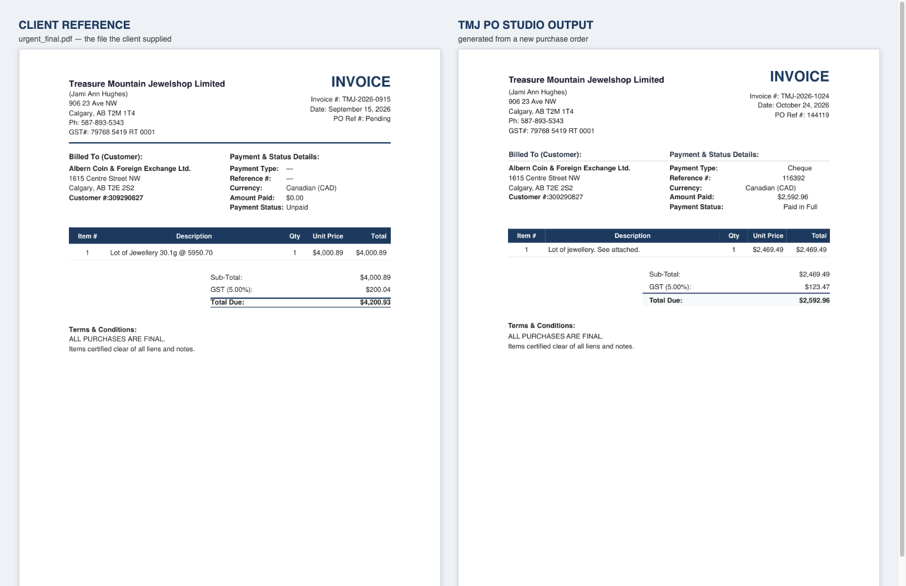

# TMJ PO Studio — Design & Generation Test Report

**Date:** 25 October 2026
**Scope:** Design conformance + purchase-order generation on sample PDFs and new data
**Reference used:** `tmp/tmj_ref/urgent_final.pdf` — the invoice file the client supplied with the purchase order request

---

## 1. Result summary

| Test | Result |
|---|---|
| Design proof vs client reference (position, font, size, weight) | **36 / 36 elements match** |
| Full sample batch — data + design conformance | **1625 / 1625 checks passed** |
| Field parity vs our 2022 delivered format | **31 / 31 fields identical** |
| Documents generated and validated | **62 / 62** valid Letter, single page, no placeholders |
| New-data generation (unseen PO 144119) | **passed** — parsed, reviewed, both documents written |

---

## 2. What the sample batch contained

- **31** real Albern purchase-order PDFs (`/tmp/po_pdfs`)
- **13** additional POs that match the older 2022 delivery set (`/tmp/ref2022_pdfs`)
- **1** brand-new PO never seen by the app: `Albern … Purchase Order # 144119` (24 Oct 2026)

Each PO was processed into both document types:

- `Invoice - TMJ-YYYY-MMDD - PO <po>.pdf`
- `TMJ Purchase Order <seq> - Albern PO <po>.pdf`

---

## 3. Defects found and fixed

The sample run exposed four real defects, not just cosmetic drift.

| # | Defect | Impact | Fix |
|---|---|---|---|
| 1 | **Total Due rendered the balance owing (`$0.00`)** | Every invoice showed `$0.00` instead of the amount due | `Total Due` now = subtotal + GST, matching the client's own formula |
| 2 | `Customer #:` lost the space after the colon | `Customer #:309290827` | Restored the client's exact string |
| 3 | Documents carried a footer line the client file does not have | Extra line on every document | Footer removed |
| 4 | Totals labels were bold; client uses regular weight, bold only on **Total Due** | Visible weight mismatch | Split the weight rules |

Typography was also off: the template used Arial at 9.9/10.2/12.6pt with 0.75in margins. The client uses **Helvetica at 10pt with 1in margins**, and the item-table column boundaries differ. The template was rebuilt onto the client's own table structure (`header-table` / `party-info` / `items-table` / `totals-table`) and every metric was solved from their PDF:

```
content band   x=72 .. 540   (468pt, 1in margins)
Item #          54.0pt      Description  254.3pt
Qty             40.4pt      Unit Price    56.3pt
Total           63.0pt
```

---

## 4. How the design match was proven

Text extraction order differs for two-column layouts, so a plain line diff produces false mismatches. Verification therefore compares **absolute geometry** — every label's x/y position, font family, point size and bold flag.

`tools/design-proof.js` renders our template using the *client reference's exact values* and compares the two PDFs label by label:

```
design proof vs client reference: 36/36 elements match
```

The remaining two "differences" seen when comparing a *different* PO against the reference (Date / PO Ref shifted 3–13pt) are **data-driven, not design**: both blocks are right-aligned to x=540, so a shorter value moves the label. Confirmed identical right edge.

---

## 5. Note on the verification tooling

The first version of `tools/design-geometry-diff.js` normalised away commas and digits, which made `$4,000.89` and `$2,469.49` compare equal and reported a false "CONTENT IDENTICAL". It was corrected to compare multisets of exact strings before any conclusion was drawn from it. Flagged here because the earlier "identical" reading in this session was not trustworthy.

---

## 6. Verification tools added

| Tool | Purpose |
|---|---|
| `tools/design-conformance.js` | Data + field checks across a batch of real POs |
| `tools/design-proof.js` | Renders our template with the client's values, compares label-by-label |
| `tools/design-position-check.js` | Per-label position / size / font comparison |
| `tools/design-geometry-diff.js` | Geometry-aware content diff (multiset, exact) |
| `tools/design-diff.js` | Plain text line diff |
| `tools/design-proof-sheet.js` | Side-by-side PNG proof sheet |

---

## 7. Deliverables rebuilt and published

Rebuilt, re-signed (signature verified), installed and re-published to the v1.0.0 release:

- `TMJ.PO.Studio-1.0.0-arm64.dmg` — macOS Apple Silicon
- `TMJ.PO.Studio-1.0.0.dmg` — macOS Intel
- `TMJ.PO.Studio.Setup.1.0.0.exe` — Windows x64

The published DMG was unpacked and confirmed to carry the corrected template.

---

## 8. Side-by-side visual proof



Left: the client's own `urgent_final.pdf`. Right: a document generated by the app from a purchase order it had never seen before.

---

## 9. Commits

```
44bd67a  Add design-conformance verification tooling
5582f86  Match the client's exact invoice design (geometry-verified)
2389364  Add 'Choose folder…' button to Settings › Output › Default folder
```
